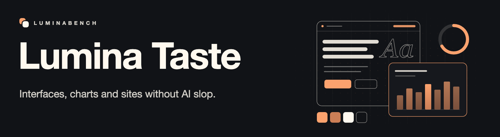
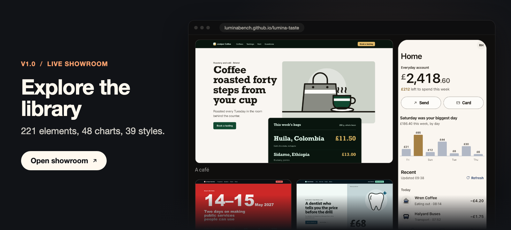

[](https://luminabench.github.io/lumina-taste/)

**Pages that look designed, not generated.** Describe a site, an app or a dashboard; your agent plans it from your words, builds it from tested parts and audits it the way a designer would. [Explore the live showroom](https://luminabench.github.io/lumina-taste/)

## Install

With Git and Node.js 22.20 or newer installed, run this and select your coding agent.

```sh
npx skills add LuminaBench/lumina-taste -g
```

Open a fresh session in your project and describe what you want built; first-run setup is automatic. Your agent can draw on 221 UI elements, 48 charts, 39 styles and 34 page and app layouts, each audited to 100/100.

<details>
<summary>Update, remove &amp; usage guides</summary>

Update your global installation, then open a fresh session.

```sh
npx skills update lumina-taste -g
```

Remove the global skill.

```sh
npx skills remove lumina-taste -g
```

Try a prompt.

> Use lumina-taste to build a website for my café: Copper Hare on Gillygate, York, flat white £3.40. Use the photos in ./our-media.

> Use lumina-taste to add a sortable accounts table and a revenue chart to my dashboard without touching my current styles.

> Use lumina-taste to audit http://localhost:3000 on mobile and in dark mode, then fix everything it finds.

**Browser checks.** The audit, the photo check and the brand kit's PNG icons use Playwright. In the skill's folder, run `npm i -D @playwright/test && npx playwright install chromium`. Pages work in current Chrome, Edge and Firefox, and in Safari 17.4 or newer. `npm run test:webkit` checks Safari's engine after `npx playwright install webkit`.

**Your own media.** A film becomes the first screen and a PDF menu becomes the prices. On a Mac this needs nothing extra; elsewhere, install `ffmpeg` and `pdftotext` (poppler).

**The showroom on your machine.**

```sh
npm install
npm run preview      # the gallery at http://127.0.0.1:4321
npm run showroom     # a static copy for any folder of a website (./showroom)
```

**From the command line.** Run these from the installed skill's folder.

```sh
node scripts/starter.mjs cafe "Copper Hare, a coffee shop in York, flat white £3.40" --project ./site
node scripts/compose.mjs "pricing page for a developer API" --project ./site --write
node scripts/search.mjs "bar when ticking rows"
node scripts/audit-ui.mjs http://localhost:3000 --taste
```

[Agent guide](SKILL.md) · [Composition](references/composition.md) · [Changelog](CHANGELOG.md)

</details>

## Licence

Use, modify and ship the components, charts, palettes and layouts in personal and commercial websites, apps and client work, royalty-free, with no credit required. The design library licence prohibits redistributing the catalogue as a competing UI kit, template pack, dataset or agent skill. [Full terms and code licence](LICENSE)

[LuminaBench](https://luminabench.com) · [Sponsor the project](https://github.com/sponsors/LuminaBench)
